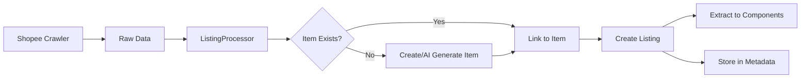

# Schema Design Documentation

> Last Updated: 2025-08-25
> Purpose: Document schema design decisions and relationships for Rate Platform

## Overview

Rate Platform uses a **three-tier content architecture** to handle multi-platform product listings and reviews:

1. **Item** - Master product reference (source of truth)
2. **Listing** - Platform-specific instances (Shopee, Lazada, etc.)
3. **Platform** - E-commerce platforms/marketplaces

## Core Entities

### 1. Item (Master Product)
**Purpose**: Single source of truth for a product across all platforms

```
Item {
  // Basic Info
  Title: string (required)
  Slug: uid
  Description: blocks
  
  // Relationships
  Category: relation
  Brand: relation
  
  // Master Data
  Variants: [component:catalog.variant]      // All possible variants
  Attributes: [component:catalog.attribute]  // Official specs
  
  // Dynamic Fields
  FieldGroups: dynamiczone                   // Flexible additional fields
}
```

**Why**: 
- Avoid duplication (1 iPhone 15 Pro, not 100 from different shops)
- Maintain accurate specs for comparison
- Enable cross-platform price comparison

### 2. Listing (Platform Instance)
**Purpose**: Specific product offering from a seller on a platform

```
Listing {
  // Basic Info
  Title: string
  URL: string
  Status: enum [pending, approved, rejected]
  
  // Relationships
  Item: relation (manyToOne)           // Links to master product
  Platform: relation (manyToOne)       // Which platform (Shopee, Lazada)
  
  // Identifiers
  ListingID: string                    // Platform's product ID
  PlatformOwnerID: string             // Seller/Shop ID
  PlatformOwnerName: string           // Seller/Shop name
  
  // Generic Fields (for fast queries)
  Price: decimal                       // Current price
  OriginalPrice: decimal              // Before discount
  Currency: string (default: VND)
  AverageRating: decimal
  TotalReviews: integer
  UsageCount: integer                 // Sales/bookings/downloads
  Stock: integer
  Location: string
  
  // Platform Data
  ListingVariants: [component]        // What's actually available
  ListingAttributes: [component]      // Shop's claimed specs
  
  // Metadata
  Metadata: json                      // Raw data from platform
  Media: media[]                      // Product images/videos
  
  // Metrics
  ViewCount: integer
  FavoriteCount: integer
  LastUpdated: datetime
  
  // Flags
  IsActive: boolean
  IsFeatured: boolean
  IsVerified: boolean
}
```

**Why**:
- Store actual market data (prices, availability)
- Enable "find cheapest" queries
- Track seller reputation
- Detect fake/incorrect information

### 3. Platform
**Purpose**: E-commerce platforms configuration

```
Platform {
  Name: string (required)
  Slug: uid
  URL: string
  Logo: media
  is_Active: boolean
  Listings: relation (oneToMany)
}
```

## Component Schemas

### catalog.variant
**Used in**: Item (master variants), Listing (available variants)

```
{
  Name: string (required)        // "Red - 128GB"
  SKU: string
  Price: decimal
  OriginalPrice: decimal
  Stock: integer
  Images: media[]
  Attributes: json               // {color: "Red", storage: "128GB"}
}
```

### catalog.attribute
**Used in**: Item (official specs), Listing (claimed specs)

```
{
  Name: string                   // "Processor"
  Value: string                  // "A17 Pro"
  Unit: string                   // "GHz", "GB", etc.
  Category: string               // "Performance", "Display", etc.
}
```

## Design Decisions & Rationale

### 1. Why Separate Item and Listing?

**Problem**: Same product appears hundreds of times across platforms
**Solution**: Item = master, Listing = instances

**Benefits**:
- Single source of truth for product info
- Compare prices across platforms
- Detect fake/incorrect listings
- Consistent reviews tied to product, not seller

### 2. Why Variants in Both Item and Listing?

**Item.Variants**: All possible variants (master reference)
- iPhone 15 Pro has: 128GB, 256GB, 512GB, 1TB

**Listing.Variants**: What's actually available at this shop
- Shop A only sells: 128GB, 256GB with specific prices

**Use Cases**:
- "Find cheapest iPhone 15 Pro 256GB" → Query Listing.Variants
- "What variants exist?" → Check Item.Variants
- Validate if shop's variants are legitimate

### 3. Why Both Components and Metadata?

**Components** (ListingVariants, ListingAttributes):
- Structured data for queries
- Type validation
- Better Admin UI
- GraphQL/REST filtering

**Metadata** (JSON):
- Preserve original platform data
- Flexible for unknown fields
- Backup/audit trail
- Platform-specific features

### 4. Why Generic Fields in Listing?

Instead of parsing JSON for every query, we extract common fields:
- `Price`, `AverageRating`, `Stock` → Fast filtering
- `UsageCount` instead of `SoldCount` → Works for products & services
- Platform-agnostic queries

### 5. Why Platform as Separate Entity?

- Configure platform-specific settings
- Track which platforms are active
- Future: Platform-specific crawling rules
- Statistics per platform

## Data Flow



## Query Examples

### Find cheapest product
```javascript
strapi.query('listing').findMany({
  where: {
    Item: { id: itemId },
    ListingVariants: {
      Name: "256GB",
      Price: { $lt: 25000000 }
    }
  },
  orderBy: { Price: 'asc' }
})
```

### Compare platforms
```javascript
strapi.query('listing').findMany({
  where: {
    Item: { id: itemId },
    Platform: { $in: ['shopee', 'lazada'] }
  },
  populate: ['Platform', 'ListingVariants']
})
```

### Detect incorrect specs
```javascript
// Compare Item.Attributes vs Listing.ListingAttributes
const item = await getItem(id);
const listing = await getListing(id);
const incorrect = listing.ListingAttributes.filter(attr => 
  attr.value !== item.Attributes.find(a => a.name === attr.name)?.value
);
```

## Migration & Maintenance

### Adding New Platforms
1. Create Platform record
2. Update crawler for platform-specific format
3. Map to generic Listing fields
4. Store platform-specific in Metadata

### Schema Evolution
- Generic fields cover 80% use cases
- Metadata JSON for platform-specific
- Components can be versioned
- Dynamic zones for future flexibility

## Best Practices

1. **Always populate Item first** (manually or AI)
2. **Use components for queryable data**
3. **Keep Metadata as backup/reference**
4. **Validate Listing data against Item**
5. **Use generic fields for cross-platform features**

## FAQs

**Q: Why not just use Metadata for everything?**
A: JSON queries are slow and not indexed. Components enable fast, typed queries.

**Q: Can one Item have multiple Listings from same shop?**
A: Yes, if they're different variants or conditions (new/used).

**Q: How to handle products not on any platform?**
A: Create Item without Listings (for review/comparison purposes).

**Q: What if platforms have different variant names?**
A: Item.Variants = canonical names, Listing.Variants = platform names, map between them.

---

*This document is living documentation. Update when schema changes.*