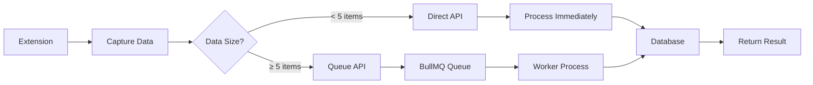

# System Architecture & Flow V2 (Updated)

## Tổng quan kiến trúc mới

Rate Platform với architecture được optimize cho stability và scalability.

```
┌─────────────────────────────────────────────────────────────┐
│                         USER LAYER                           │
├───────────────────┬───────────────────┬───────────────────┤
│   Web Frontend    │  Browser Extension │   Mobile App      │
│   (Next.js 15)    │  (Manifest V3)     │   (Future)        │
└───────────────────┴───────────────────┴───────────────────┘
                              │
                    ┌─────────┴─────────┐
                    │   API GATEWAY      │
                    │   (Strapi CMS)     │
                    │   + REST Cache     │
                    └─────────┬─────────┘
                              │
                 ┌────────────┴────────────┐
                 │  Unified Validation     │
                 │      Service             │
                 └────────────┬────────────┘
                              │
            ┌─────────────────┼─────────────────┐
            │                 │                 │
     ┌──────┴──────┐   ┌─────┴─────┐   ┌──────┴──────┐
     │   Direct    │   │  BullMQ   │   │     AI      │
     │ Processing  │   │   Queue   │   │  Analysis   │
     │ (< 5 items) │   │ (≥ 5 items)│   │ (GPT-4o)    │
     └──────┬──────┘   └─────┬─────┘   └──────┬──────┘
            │                 │                 │
            └─────────────────┼─────────────────┘
                              │
                    ┌─────────┴─────────┐
                    │   PostgreSQL 17   │
                    │    (Database)     │
                    └───────────────────┘
```

## Caching Layer (REST Cache với Redis)

### REST Cache Plugin Configuration
```typescript
// Strapi 5 với @strapi-community/plugin-rest-cache
{
  provider: "redis",  // Sử dụng Redis thay vì memory
  options: {
    max: 32767,
    ttl: 3600000,    // 1 hour default
    connection: "default"
  }
}
```

### Cache Strategy by Content Type
| Content Type | TTL | Reason |
|-------------|-----|--------|
| Listings | 1 hour | Cập nhật thường xuyên |
| Categories | 24 hours | Ít thay đổi |
| Reviews | 30 minutes | Real-time feedback |
| Items | 1 hour | Stock updates |
| Platforms | 24 hours | Static data |

### Cache Invalidation
- Auto clear on CREATE/UPDATE/DELETE
- Clear related cache on relationship changes
- Manual clear via API: `/api/cache/clear`

## Flow chính của hệ thống (V2)

### 1. Extension → API Flow (Simplified)



### 2. API Endpoints (New)

#### 2.1 Direct Processing Endpoint
```typescript
POST /api/listings/create-from-shopee
Query params:
  - source: "extension" | "crawler" | "manual"
  - queue: "true" | "false" (auto if > 5 items)

Response:
{
  success: boolean,
  queued: boolean,
  listingId?: string,
  jobId?: string,
  warnings?: string[]
}
```

#### 2.2 Queue Status Endpoint
```typescript
GET /api/queue/stats
Response:
{
  waiting: number,
  active: number,
  completed: number,
  failed: number
}
```

### 3. Unified Validation Service

All data sources go through centralized validation:

```typescript
class UnifiedValidationService {
  validate(data, source) {
    // 1. Normalize data format
    // 2. Basic validation
    // 3. Business rules
    // 4. AI scam detection
    // 5. Duplicate check
    return {
      isValid: boolean,
      errors: string[],
      warnings: string[],
      normalizedData: object
    }
  }
}
```

### 4. BullMQ Queue Processing

#### 4.1 Queue Configuration
```javascript
const queue = new Queue('listing-import', {
  connection: redisConnection,
  defaultJobOptions: {
    removeOnComplete: { age: 3600, count: 100 },
    removeOnFail: { age: 86400, count: 50 },
    attempts: 3,
    backoff: { type: 'exponential', delay: 2000 }
  }
});
```

#### 4.2 Worker Configuration
```javascript
const worker = new Worker('listing-import', processJob, {
  connection: redisConnection,
  concurrency: 10,  // Process 10 jobs concurrently
  limiter: {
    max: 100,       // Max 100 jobs
    duration: 60000 // Per minute
  }
});
```

### 5. Processing Logic

```
Input → Validation → Processing Decision → Storage
           │              │
           ↓              ↓
      [Valid?]      [Size Check]
         │               │
    No → Error      < 5 → Direct
         │          ≥ 5 → Queue
    Yes → Continue
```

### 6. Extension Updates Required

#### Current (Old):
```javascript
// Extension sending to validation API
fetch('http://localhost:1337/api/validation/validate', {
  method: 'POST',
  body: JSON.stringify({ items: [...] })
})
```

#### New:
```javascript
// Extension sending to new API
fetch('http://localhost:1337/api/listings/create-from-shopee', {
  method: 'POST',
  body: JSON.stringify({ items: [...] }),
  params: { source: 'extension' }
})
```

### 7. Workers to Remove

These services are no longer needed:
- `/apps/strapi/src/services/redisStream.ts` ❌
- `/apps/strapi/src/services/redisWorker.ts` ❌
- `/Modules/Validator/` (Python worker) ❌

### 8. New Services

These services replace the old ones:
- `/apps/strapi/src/services/bullmqQueue.ts` ✅
- `/apps/strapi/src/services/unifiedValidation.ts` ✅
- `/apps/strapi/src/api/listing/services/queue.ts` ✅

### 9. Benefits of New Architecture

| Aspect | Old (Redis Stream) | New (BullMQ) |
|--------|-------------------|--------------|
| Setup Complexity | High | Low |
| Error Handling | Manual | Built-in |
| Retry Logic | Manual | Automatic |
| Rate Limiting | Manual | Built-in |
| Monitoring | Custom | Bull Board |
| Scalability | Good | Excellent |
| Maintenance | High | Low |

### 10. Migration Checklist

- [x] Install BullMQ and ioredis
- [x] Create UnifiedValidationService
- [x] Create BullMQ Queue Service
- [x] Update Strapi bootstrap
- [x] Create new API endpoints
- [x] Install REST Cache plugin with Redis
- [ ] Update Extension to use new API
- [ ] Remove old Redis Stream services
- [ ] Test end-to-end flow
- [ ] Deploy to staging
- [ ] Monitor for 24h
- [ ] Deploy to production

### 11. Monitoring & Debugging

#### Bull Board Dashboard
```bash
# Access at http://localhost:1337/admin/bull-board
# Shows:
- Queue depth
- Job status
- Processing rate
- Failed jobs
- Retry attempts
```

#### Logging
```typescript
// Structured logging
{
  timestamp: "2025-01-10T00:00:00Z",
  service: "bullmq",
  jobId: "123",
  status: "completed",
  duration: 1234,
  data: {...}
}
```

### 12. Scaling Strategy

#### Development
```javascript
{ concurrency: 5, workers: 1 }
```

#### Staging
```javascript
{ concurrency: 10, workers: 2 }
```

#### Production
```javascript
{ 
  concurrency: 20,
  workers: "auto-scale 1-10",
  redis: "cluster mode"
}
```

### 13. Error Recovery

```
Job Failed → Retry (3x) → Dead Letter Queue → Manual Review
     ↓            ↓              ↓
   Log     Exponential    Alert Admin
           Backoff
```

### 14. Performance Targets

- Direct processing: < 500ms
- Queue processing: < 2s per job
- Validation: < 100ms
- AI analysis: < 1s
- Total end-to-end: < 3s

### 15. Security Improvements

- Unified validation prevents injection
- Rate limiting prevents DoS
- Queue prevents overwhelming system
- Better error messages (no stack traces in production)

## Conclusion

The new architecture is:
- ✅ Simpler to understand
- ✅ Easier to maintain
- ✅ More reliable
- ✅ Better scalability
- ✅ Production-ready

Next steps:
1. Update Extension
2. Remove old code
3. Test thoroughly
4. Deploy gradually