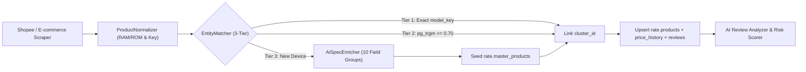

# 🗺️ Rate Platform Roadmap — Kiến Trúc Zero-Strapi & Open-Core 2026

> **Cập nhật lần cuối:** Tháng 10/2026  
> **Kiến trúc hiện tại:** Next.js 16 + Pure PostgreSQL 17 (Supabase Cloud `rate` schema) + Open-Core 2 Repositories (`DOS/Rate` & `DOS/Rate-Services`)  
> **GitHub Project Board (Multi-Agent Queue):** [https://github.com/orgs/DOS/projects/9](https://github.com/orgs/DOS/projects/9)  
> **Trạng thái:** Đang triển khai Phase 3 (AI Review Intelligence & Data Backfill)

---

## 1. Tầm Nhìn & Kiến Trúc Cốt Lõi (Zero-Strapi + Open-Core 2 Repos)

Hệ thống **Rate Platform** đã chuyển dịch hoàn toàn khỏi mô hình Strapi CMS + Splink Python cũ sang kiến trúc **Pure PostgreSQL 17 (`rate` schema)**, đồng thời phân tách thành **2 Repositories** để vừa minh bạch thuật toán chấm điểm với cộng đồng, vừa bảo mật tuyệt đối công cụ cào dữ liệu:

- **Mô hình Open-Core 2 Repositories:**
  - 🌍 **[`DOS/Rate`](https://github.com/DOS/Rate) (Public Open-Core — `D:\Projects\Rate`):** Chứa Web UI (`apps/web`), Browser Extension (`apps/extension`), chuẩn 10 nhóm thông số (`packages/shared-data`), Database Migrations (`supabase/migrations`), và bộ não chuẩn hóa/chấm điểm công khai (`product-normalizer.ts`, `entity-matcher.ts`, `ai-spec-enricher.ts`, `ai-review-analyzer.ts`, `shopee-to-supabase.ts`).
  - 🔒 **[`DOS/Rate-Services`](https://github.com/DOS/Rate-Services) (Private Enterprise — `D:\Projects\Rate-Services`):** Chứa toàn bộ Scraper vượt tường lửa (`shopee-scraper.ts`, `shopee-search-scraper.ts`, `sniff-search-api.ts`), giải Captcha (`shopee-captcha-solver.ts`), xoay Proxy (`proxy-manager.ts`), và Queue Workers (`queue-worker.ts`) chạy định kỳ trên GitHub Actions Enterprise.
- **Kiến trúc Sản phẩm 2 Tầng (Two-Tier Product Model):**
  - **Tầng 1 — `rate.master_products` (Sản phẩm gốc chuẩn hóa):** Mỗi dòng máy + dung lượng (ví dụ `apple:iphone-16-pro-max:256gb`) là một thực thể chuẩn duy nhất, lưu trữ **10 Field Groups** thông số kỹ thuật (`JSONB` + GIN Index) và giá `min_price` / `max_price` tổng hợp từ toàn thị trường.
  - **Tầng 2 — `rate.products` (Gian hàng / Chào giá từ các sàn):** Lưu các listing thực tế cào từ Shopee (và mở rộng sang Lazada, Tiki, đại lý bán lẻ), liên kết về sản phẩm gốc qua `cluster_id`, kèm lịch sử biến động giá (`rate.price_history`) và đánh giá người mua (`rate.reviews`).
- **Chuẩn Thông Số Kỹ Thuật 10 Nhóm (PhoneArena Structure + GSMArena Depth):**
  - Tổ chức thành 10 nhóm chuẩn: `availability`, `design`, `display`, `hardware`, `battery`, `camera`, `connectivity`, `cellular`, `multimedia`, `regulatory`.
  - Tách bạch từng ống kính (`main_camera`, `second_camera`, `third_camera`, `fourth_camera`, `front_camera`) theo chuẩn PhoneArena, kết hợp độ sâu phần cứng của GSMArena.
- **3-Tier Entity Matching & Provider-Agnostic AI Spec Enricher:**
  - **Tier 1:** Khớp chính xác theo `model_key` (`brand:model:storage`).
  - **Tier 2:** Khớp mờ qua PostgreSQL `pg_trgm` (`match_master_product` RPC, ngưỡng tương đồng $\ge 0.70$).
  - **Tier 3:** Tự động gọi `AiSpecEnricher` (hỗ trợ đa provider: OpenAI, DOS-AI Gateway, Gemini, DeepSeek, Groq, OpenRouter, Ollama) để điền đầy đủ 10 nhóm thông số chuẩn trước khi khởi tạo Master Product mới.

---

## 2. Lộ Trình Triển Khai Chi Tiết (Phases)

### ✅ Phase 1: Nền Tảng Database PostgreSQL 17 & Schema 2 Tầng (Đã hoàn thành)
- [x] Khởi tạo schema `rate` trên Supabase Cloud (`master_products`, `products`, `merchants`, `categories`, `price_history`, `reviews`, `review_flags`).
- [x] Thiết lập hệ thống hàng đợi cào dữ liệu thuần Postgres (`rate.crawl_jobs`, `rate.crawl_runs`) với các `SECURITY DEFINER` RPCs (`dequeue_crawl_job`, `heartbeat_crawl_job`, `checkpoint_crawl_job`, `ack_crawl_job`, `fail_crawl_job`).
- [x] Định nghĩa bộ Schema Zod & TypeScript cho **10 Field Groups** tại `packages/shared-data/src/schemas/specs.schema.ts`.
- [x] Xây dựng hàm PostgreSQL `match_master_product` sử dụng `pg_trgm` kết hợp lọc cứng theo `brand` và `storage_gb`.
- [x] Cấu hình triggers tự động cập nhật `min_price`, `max_price`, `merchant_count` trên `rate.master_products`.

---

### ✅ Phase 2: Pipeline Cào Dữ Liệu, Dedupe & AI Spec Enricher (Đã hoàn thành)
- [x] **Shopee Scraper & Anti-Detect Proxy:** Tích hợp `mproxy.vn` xoay IP, xử lý trạng thái trượt captcha và bóc tách chi tiết sản phẩm, biến thể màu sắc, đánh giá người dùng (`shopee-scraper.ts`).
- [x] **Queue-Driven Worker (`queue-worker.ts`):** Cơ chế nhận job theo lease, gửi heartbeat định kỳ, lưu checkpoint từng bước (`merchant` $\rightarrow$ `master` $\rightarrow$ `listing` $\rightarrow$ `price` $\rightarrow$ `reviews`) và chống trùng lặp `observation_id` cho lịch sử giá.
- [x] **RAM/ROM-Aware `ProductNormalizer` (`product-normalizer.ts`):** Thuật toán nhận diện chính xác dung lượng RAM và ROM trong tiêu đề tiếng Việt phức tạp (ví dụ: `"Samsung Galaxy A55 8GB RAM 256GB"` $\rightarrow$ ROM `256GB`, RAM `8GB`).
- [x] **Provider-Agnostic `AiSpecEnricher` (`ai-spec-enricher.ts`):**
  - Hỗ trợ bất kỳ LLM nào qua giao thức chuẩn OpenAI-compatible (`openai`, `dos-ai`, `gemini`, `deepseek`, `groq`, `openrouter`, `ollama`).
  - Sanitizer tự động ép kiểu số học/boolean và kiểm증 qua Zod Schema 10 nhóm.
  - Tích hợp trực tiếp vào **Tier 3** của `EntityMatcher` + hỗ trợ hàm `enrichMasterProductById()` để backfill sản phẩm cũ.
- [x] **Web UI Cơ Bản & Đa Ngôn Ngữ (`apps/web`):**
  - Nâng cấp Next.js 16, React 19, đồng bộ chuyển đổi ngôn ngữ Tiếng Việt / Tiếng Anh / Tiếng Séc với SVG Flag.
  - Xây dựng các trang `/smartphones` (danh mục Master Products), `/smartphones/[slug]` (chi tiết 10 nhóm thông số + so sánh nơi bán + đánh giá), và `/compare` (so sánh song song 2–3 máy).

---

### 🔥 Phase 3: AI Review Intelligence, Chấm Điểm Rủi Ro Shop & Làm Giàu Dữ Liệu Thực Tế (Đang thực hiện — Ưu tiên tiếp theo)
- [ ] **3.1. Module AI Review Analyzer (`apps/importer/src/shopee/ai-review-analyzer.ts`):**
  - Phân tích các đánh giá trong `rate.reviews` chưa có bản ghi `rate.review_flags`.
  - Phát hiện review seeding, spam nhận xu, văn mẫu lặp lại, hoặc bình luận không khớp sản phẩm.
  - Ghi kết quả vào `rate.review_flags` (`verdict`: `'authentic' | 'suspicious' | 'fake'`, `fake_probability`: `0.0 - 1.0`, `reasons`).
- [ ] **3.2. Module Merchant Risk Scorer (`rate.merchants.risk_score`):**
  - Tính toán chỉ số rủi ro của gian hàng (`0 - 100`) dựa trên: tỷ lệ review ảo, độ lệch giá bất thường so với `min_price` thị trường, trạng thái Mall/Official, tuổi đời & số người theo dõi.
  - Tự động cập nhật `rate.merchants.risk_score` và `rate.master_products.avg_trust_score`.
- [ ] **3.3. Batch Crawl & Backfill Dữ Liệu Thực Tế Lên Supabase Cloud:**
  - Chạy script backfill làm giàu toàn bộ `master_products` hiện có trên Supabase bằng `AiSpecEnricher`.
  - Nạp thêm danh mục các dòng điện thoại phổ biến tại Việt Nam (iPhone 15/16 series, Samsung Galaxy S24/A55 series, Xiaomi 14/Redmi Note 13 series, OPPO Find X8/Reno12 series).

---

### 🚀 Phase 4: Nâng Cấp Trải Nghiệm Tìm Kiếm, Bộ Lọc 10 Nhóm & Biểu Đồ Giá Trên Web (`apps/web`)
- [ ] **4.1. Bộ Lọc Đa Tiêu Chí Theo Thông Số (Faceted Spec Filter trên `/smartphones`):**
  - Lọc trực tiếp trên cột số học và JSONB của `rate.master_products`:
    - Hãng sản xuất (`Apple`, `Samsung`, `Xiaomi`, `OPPO`, `Vivo`, ...)
    - Khoảng giá (`Dưới 7 triệu`, `7 - 15 triệu`, `Trên 15 triệu`)
    - Dung lượng RAM (`8GB`, `12GB`, `16GB`) & Bộ nhớ trong (`128GB`, `256GB`, `512GB`, `1TB`)
    - Dung lượng Pin ($\ge 5000\text{ mAh}$), Tần số quét màn hình ($120\text{Hz}$), Hỗ trợ 5G.
  - Sắp xếp theo: Giá thấp nhất, Điểm tin cậy cao nhất, Nhiều nơi bán nhất, Mới ra mắt.
- [ ] **4.2. Biểu Đồ Lịch Sử Giá (`Price History Chart` trên `/smartphones/[slug]`):**
  - Truy vấn bảng `rate.price_history` và vẽ biểu đồ biến động giá theo ngày cho từng gian hàng.
  - Cảnh báo chiêu trò **"Tăng giá gốc rồi gắn nhãn Siêu Sale"** (Fake Discount Detection).
- [ ] **4.3. Thanh Tìm Kiếm Thông Minh & Chọn Máy So Sánh Động (`/compare`):**
  - Thêm ô tìm kiếm Autocomplete ngay trên trang `/compare` và `/smartphones` để người dùng tự thêm/bớt bất kỳ mẫu điện thoại nào vào bảng đối chiếu 10 nhóm thông số.

---

### 🔮 Phase 5: Mở Rộng Đa Sàn & Browser Extension
- [ ] **5.1. Đa sàn thương mại điện tử & Chuỗi bán lẻ:**
  - Mở rộng Importer sang **Lazada**, **Tiki**, **CellphoneS**, **Thế Giới Di Động**, **FPT Shop** — tất cả cùng gom về chung `rate.master_products` qua `EntityMatcher`.
- [ ] **5.2. Rate Browser Extension (Manifest V3):**
  - Khi người dùng đang xem một trang sản phẩm trên Shopee/Lazada, popup của Extension hiển thị ngay:
    - Giá thấp nhất ở các sàn khác cho cùng mẫu máy (`master_product`).
    - Điểm tin cậy thực tế & tỷ lệ review ảo (`review_flags`) của shop đó.
    - Biểu đồ lịch sử giá 30/90 ngày qua.

---

## 3. Thứ Tự Gợi Ý Các Task Tiếp Theo (Actionable Queue)

| Thứ tự | Hạng mục (Task) | Module / File chính | Giá trị mang lại |
| :---: | :--- | :--- | :--- |
| **Task 1** | **Backfill & Seed Master Products với AI Spec Enricher** | `apps/importer/src/shopee/test-ai-enricher.ts` | Đảm bảo toàn bộ sản phẩm trên Supabase Cloud có đủ 10 nhóm thông số chuẩn hiển thị ngay trên Web |
| **Task 2** | **Xây dựng AI Review Analyzer & Merchant Risk Scorer** | `apps/importer/src/shopee/ai-review-analyzer.ts` | Lấp đầy bảng `rate.review_flags` và `risk_score` để các nhãn *"Đánh giá thật / Nghi vấn seeding"* trên UI hoạt động thực tế |
| **Task 3** | **Bộ lọc thông số (Faceted Filter) & Tìm kiếm trên `/smartphones`** | `apps/web/src/app/[locale]/smartphones/page.tsx` | Cho phép người dùng lọc điện thoại theo Hãng, Giá, RAM, ROM, Pin, 120Hz |
| **Task 4** | **Biểu đồ Lịch sử giá (`price_history`) & Chọn máy so sánh động** | `apps/web/src/app/[locale]/smartphones/[slug]/page.tsx` | Hoàn thiện tính năng phát hiện giảm giá ảo và nâng cấp trang `/compare` |
