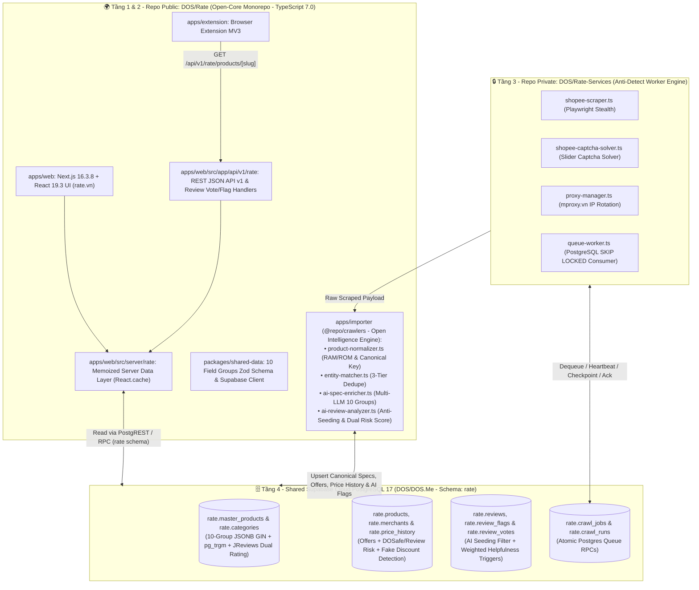

# ⭐ Rate Platform (`rate.vn`) - Open-Core Product Intelligence & Anti-Scam Ecosystem


Nền tảng đối chiếu giá đa sàn, chuẩn hóa **10 nhóm thông số kỹ thuật (PhoneArena + GSMArena standard)**, kiểm chứng **Giảm giá ảo (Fake Discount Detector)** và **phát hiện đánh giá ảo (Seeding / Spam xu) & chấm điểm rủi ro gian hàng kép (DOSafe + AI Review)** theo triết lý **Open-Core minh bạch**.

- 🌐 **Production Web:** [https://rate.vn](https://rate.vn)
- 📋 **GitHub Project Board (Multi-Agent Task Queue):** [https://github.com/orgs/DOS/projects/9](https://github.com/orgs/DOS/projects/9)
- 🗺️ **Roadmap chi tiết:** [`Docs/Resources/ROADMAP.md`](./Docs/Resources/ROADMAP.md)
- 🔬 **Báo cáo Thiết kế Kiến trúc & Tech Stack 2026 (Dark HTML):** [`Docs/Proposals/2026-10-14-full-stack-tech-architecture-audit.html`](./Docs/Proposals/2026-10-14-full-stack-tech-architecture-audit.html)
- 🤖 **Quy chuẩn làm việc cho AI Agents:** [`AGENTS.md`](./AGENTS.md)

---

## 🛠️ Tech Stack Chuẩn Hóa 2026 (Zero-Strapi Architecture)

| Tầng Kiến Trúc                    | Công Nghệ & Phiên Bản Chuẩn                                                                                              | Vai Trò Cốt Lõi                                                                                                                                          |
| :-------------------------------- | :----------------------------------------------------------------------------------------------------------------------- | :------------------------------------------------------------------------------------------------------------------------------------------------------- |
| **Ngôn ngữ & Trình biên dịch**    | **TypeScript 7.0 (`^7.0.2`)** + **Node.js `>= 22 / 26`**                                                                 | Kiểm tra kiểu dữ liệu nghiêm ngặt (`ignoreBuildErrors: false`) trên toàn Monorepo                                                                        |
| **Monorepo & Build System**       | **`pnpm@10.34.5`** Workspaces + **`Turborepo ^2.10.12`**                                                                 | Điều phối build song song, bộ nhớ đệm `.turbo` cho `@repo/shared-data`, `@repo/crawlers`, `@repo/web`                                                    |
| **Web Frontend & BFF Layer**      | **Next.js 16.3.8** (App Router + Turbopack) + **React 19.3.0** + **Bootstrap 5.3.8** + **`next-intl 4.14.8`**            | Server Components mặc định, URL-driven 10-Field-Group Faceted Filter, SVG Time-Series Price History Chart, JReviews Dual-Rating UI                       |
| **Backend Server & REST API**     | **Next.js 16 Server Data Layer (`apps/web/src/server/rate/`)** + **Route Handlers (`/api/v1/rate/*`, `/api/reviews/*`)** | Deduplication với `React.cache()`, REST JSON API v1 phục vụ Web Client, Browser Extension MV3 và đối tác                                                 |
| **Open-Core Intelligence Engine** | **`apps/importer` (`@repo/crawlers`)** + **`packages/shared-data`** (Zod `^3.25.76`)                                     | `ProductNormalizer` (RAM/ROM), `EntityMatcher` (3-Tier Dedupe), `AiSpecEnricher` (10 nhóm thông số), `AiReviewAnalyzer` (Anti-Seeding & Dual Risk Score) |
| **AI Gateway & LLM Providers**    | **OpenAI-Compatible Multi-Provider SDK** (`dos-ai`, `openai`, `gemini`, `deepseek`, `groq`, `openrouter`, `ollama`)      | Kết nối trực tiếp DOS-AI Gateway (`api.dos.ai` / vLLM Qwen) hoặc bất kỳ LLM nào qua cấu hình biến môi trường                                             |
| **Private Anti-Detect Workers**   | **`DOS/Rate-Services`** (Playwright Stealth + `mproxy.vn` + Slider Captcha Solver)                                       | Worker nhận job từ hàng đợi Postgres (`rate.crawl_jobs`), vượt tường lửa sàn TMĐT và đẩy dữ liệu thô về DB                                               |
| **Database, Queue & Auth**        | **Supabase Cloud PostgreSQL 17 (`rate` schema)** + **DOS.Me Auth**                                                       | Kiến trúc sản phẩm 2 tầng, `JSONB` GIN Index, `pg_trgm` fuzzy matching, `SECURITY DEFINER` triggers & RLS                                                |

---

## 🏗️ Kiến Trúc Backend & Full-Stack 4 Tầng (Open-Core 2 Repositories)



---

## 📊 Mô Hình Dữ Liệu 2 Tầng Trên PostgreSQL 17 (`rate` Schema)

1. **Tầng 1 - `rate.master_products` (Sản phẩm gốc chuẩn hóa):**
   - Định danh duy nhất qua `model_key` (`brand:model:storage`, ví dụ `samsung:galaxy-s24-ultra:256gb`).
   - Lưu trữ **10 Field Groups** chuẩn hóa trong cột `specifications` (`JSONB` với GIN index): `availability`, `design`, `display`, `hardware`, `battery`, `camera`, `connectivity`, `cellular`, `multimedia`, `regulatory`.
   - Tổng hợp tự động `min_price`, `max_price`, `merchant_count`, `user_rating_weighted`, `expert_rating`, `authentic_review_count`.
2. **Tầng 2 - `rate.products` (Listings / Chào giá từ các sàn):**
   - Lưu trữ từng gian hàng bán sản phẩm trên Shopee/Lazada/Tiki, liên kết về sản phẩm gốc qua `cluster_id`.
   - Tách bạch điểm rủi ro gian hàng thành `dosafe_risk_score` (từ `dosafe.threat_intel`) và `review_risk_score` (từ tỷ lệ review seeding/ảo).
   - Theo dõi lịch sử biến động giá theo thời gian (`rate.price_history`) để phát hiện hành vi nâng khống giá gốc trước ngày Sale.

---

## 🚀 Hướng Dẫn Cài Đặt & Phát Triển Nhanh

### Yêu cầu hệ thống

- **Node.js**: `>= 22.0.0` (khuyến nghị `24.x` / `26.x`)
- **Package Manager**: `pnpm@10.34.5`
- **TypeScript**: `7.0.2`

### Các lệnh thường dùng (`D:\Projects\Rate`)

```powershell
# 1. Cài đặt dependencies toàn monorepo
pnpm install

# 2. Build gói schema dùng chung (@repo/shared-data)
pnpm --filter @repo/shared-data build

# 3. Kiểm tra kiểu dữ liệu TypeScript 7.0 & Build Web UI (Next.js 16)
pnpm --filter @repo/web typecheck
pnpm --filter @repo/web build

# 4. Chạy Web UI ở chế độ Development (http://localhost:3000)
pnpm --filter @repo/web dev

# 5. Build & chạy kiểm thử bộ não chuẩn hóa AI (@repo/crawlers)
pnpm --filter @repo/crawlers build
pnpm --filter @repo/crawlers exec tsx src/shopee/test-ai-enricher.ts
pnpm --filter @repo/crawlers exec tsx src/shopee/test-review-analyzer.ts
```
