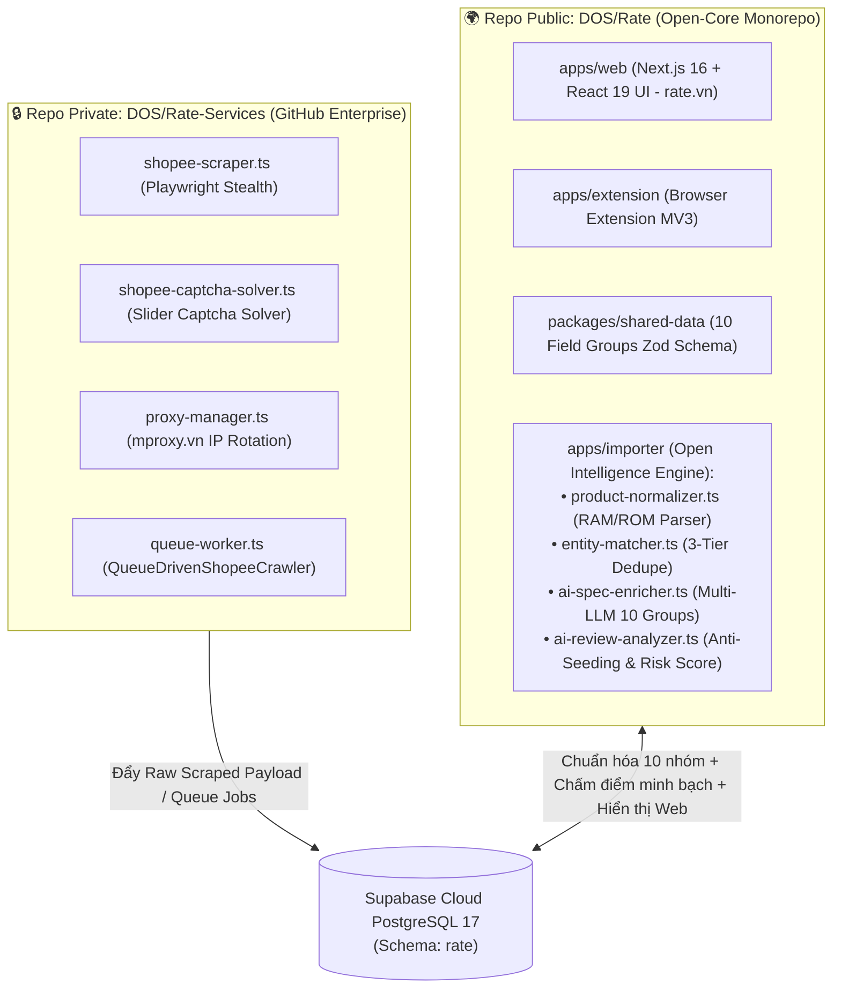

# ⭐ Rate Platform (`rate.vn`) — Open-Core Product Intelligence & Anti-Scam Ecosystem


Nền tảng đối chiếu giá đa sàn, chuẩn hóa **10 nhóm thông số kỹ thuật (PhoneArena + GSMArena standard)** và **phát hiện đánh giá ảo (Seeding / Fake Review) & chấm điểm rủi ro gian hàng** bằng AI theo triết lý **Open-Core minh bạch**.

- 🌐 **Production Web:** [https://rate.vn](https://rate.vn)
- 📋 **GitHub Project Board (Multi-Agent Task Queue):** [https://github.com/orgs/DOS/projects/9](https://github.com/orgs/DOS/projects/9)
- 🗺️ **Roadmap chi tiết:** [`Docs/Resources/ROADMAP.md`](./Docs/Resources/ROADMAP.md)
- 🤖 **Quy chuẩn làm việc cho AI Agents:** [`AGENTS.md`](./AGENTS.md)

---

## 🏗️ Kiến Trúc Open-Core 2 Repositories (Zero-Strapi 2026)

Để vừa đảm bảo **tính minh bạch tuyệt đối** của thuật toán chấm điểm/chuẩn hóa thông số với cộng đồng, vừa **bảo mật tuyệt đối** các công cụ thu thập dữ liệu vượt tường lửa (anti-bot, giải captcha, xoay proxy), hệ thống được tách thành **2 repositories** trên tổ chức GitHub Enterprise **DOS**:



| Repository | Độ riêng tư | Đường dẫn Local | Vai trò & Các thành phần chính |
| :--- | :---: | :--- | :--- |
| **[`DOS/Rate`](https://github.com/DOS/Rate)** | 🌍 **Public (Open-Core)** | `D:\Projects\Rate` | • **`apps/web`**: Giao diện Web Next.js 16 (`rate.vn`) đa ngôn ngữ (`vi`, `en`, `cs`)<br/>• **`packages/shared-data`**: Bộ Schema Zod chuẩn 10 Field Groups (`specs.schema.ts`)<br/>• **`apps/importer`**: Bộ não chuẩn hóa & chấm điểm công khai (`product-normalizer.ts`, `entity-matcher.ts`, `ai-spec-enricher.ts`, `shopee-to-supabase.ts`, `types.ts`)<br/>• **`supabase/migrations`**: Toàn bộ DDL, 인덱스 GIN, `pg_trgm` và Queue RPCs của schema `rate` |
| **[`DOS/Rate-Services`](https://github.com/DOS/Rate-Services)** | 🔒 **Private (Enterprise)** | `D:\Projects\Rate-Services` | • **Anti-Detect Scrapers**: `shopee-scraper.ts`, `shopee-search-scraper.ts`, `sniff-search-api.ts`<br/>• **Bypass & Proxy**: `shopee-captcha-solver.ts`, `proxy-manager.ts` (`mproxy.vn`)<br/>• **Background Workers**: `queue-worker.ts`, `crawl-smartphones-with-proxy.ts`<br/>• **Scheduled Actions**: Chạy định kỳ bằng hạn mức 50,000 phút/tháng của GitHub Enterprise `DOS` |

---

## 📊 Mô Hình Dữ Liệu 2 Tầng Trên PostgreSQL 17 (`rate` Schema)

Hệ thống loại bỏ hoàn toàn Strapi CMS và Splink Python cồng kềnh, sử dụng trực tiếp **PostgreSQL 17 trên Supabase Cloud (`rate` schema)**:

1. **Tầng 1 — `rate.master_products` (Sản phẩm gốc chuẩn hóa):**
   - Định danh duy nhất qua `model_key` (`brand:model:storage`, ví dụ `samsung:galaxy-s24-ultra:256gb`).
   - Lưu trữ **10 Field Groups** chuẩn hóa trong cột `specifications` (`JSONB` với GIN index): `availability`, `design`, `display`, `hardware`, `battery`, `camera`, `connectivity`, `cellular`, `multimedia`, `regulatory`.
   - Tổng hợp tự động `min_price`, `max_price`, `merchant_count`, `avg_rating`, `avg_trust_score`.
2. **Tầng 2 — `rate.products` (Listings / Chào giá từ các sàn):**
   - Lưu trữ từng gian hàng bán sản phẩm trên Shopee/Lazada/Tiki, liên kết về sản phẩm gốc qua `cluster_id`.
   - Theo dõi lịch sử biến động giá theo ngày (`rate.price_history`) và đánh giá người mua (`rate.reviews` + `rate.review_flags`).

---

## 🚀 Hướng Dẫn Cài Đặt & Phát Triển Nhanh

### Yêu cầu hệ thống
- **Node.js**: `>= 20.x` (khuyến nghị `22.x`+)
- **Package Manager**: `pnpm` (Monorepo workspace)

### Các lệnh thường dùng (`D:\Projects\Rate`)

```powershell
# 1. Cài đặt dependencies toàn monorepo
pnpm install

# 2. Chạy Web UI (Next.js 16 trên http://localhost:3000)
pnpm --filter web dev

# 3. Kiểm tra & chạy bộ test AI Spec Enricher (10 Field Groups)
pnpm --filter @repo/crawlers exec tsx src/shopee/test-ai-enricher.ts

# 4. Backfill 10 nhóm thông số cho toàn bộ Master Products trên Supabase Cloud
pnpm --filter @repo/crawlers exec tsx src/shopee/test-ai-enricher.ts --backfill

# 5. Build kiểm tra TypeScript
pnpm --filter @repo/crawlers build
pnpm --filter web build
```

---

## 🤖 Quy Trình Làm Việc Đa Agent (Multi-Agent Workflow)

Dự án được phát triển song song bởi nhiều AI Agents (Claude Code, Antigravity, Codex, Cursor). Để **không bao giờ bị trùng lặp task**, mọi Agent **BẮT BUỘC** phải đọc và tuân thủ [`AGENTS.md`](./AGENTS.md):

1. Kiểm tra danh sách Issue và bảng **[GitHub Project #9](https://github.com/orgs/DOS/projects/9)** trước khi code.
2. Nhận (Claim) Issue hoặc tạo Issue mới nếu chưa có, gắn nhãn `status:in-progress` (và chuyển cột sang **In Progress** trên Project #9).
3. Kiểm thử đầy đủ (`build` + `test`) trước khi báo cáo hoàn thành.
4. Cập nhật trạng thái Issue sang `status:in-review` hoặc `status:done` (và chuyển cột tương ứng trên Project #9) sau khi push.
